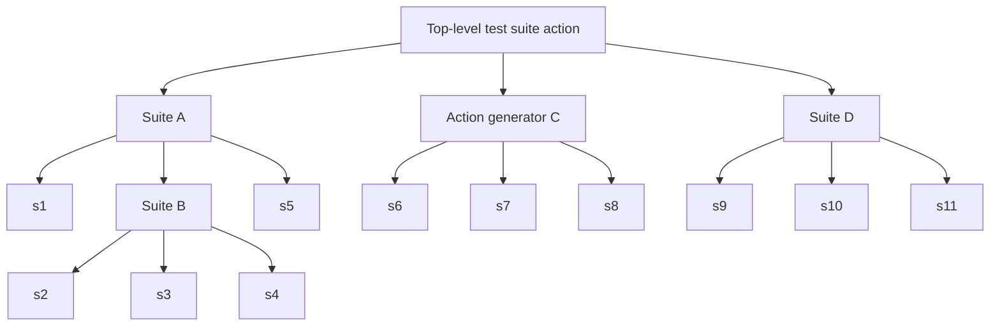
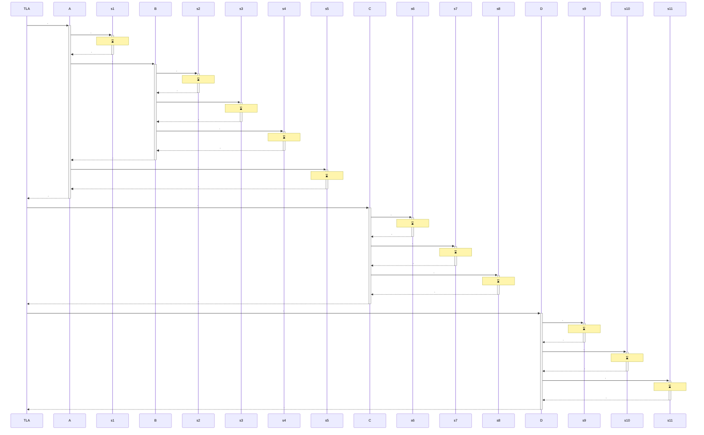
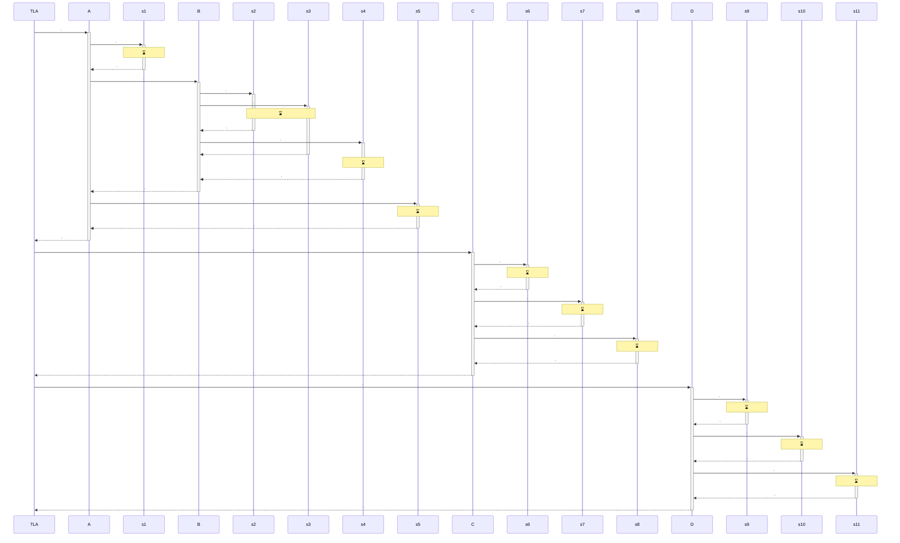
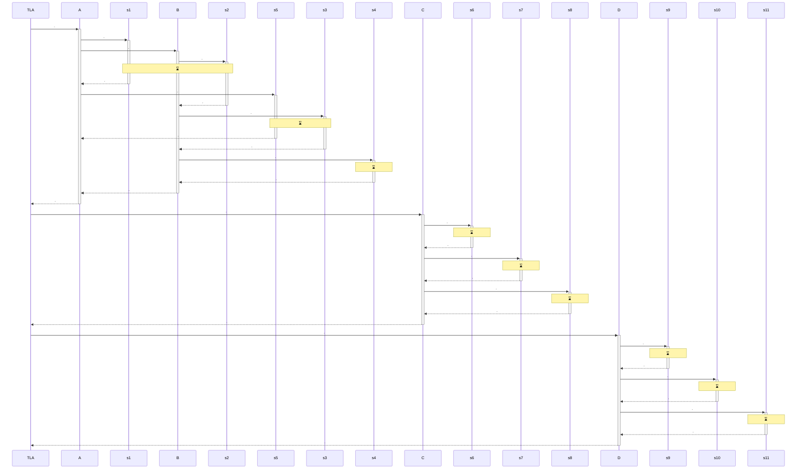
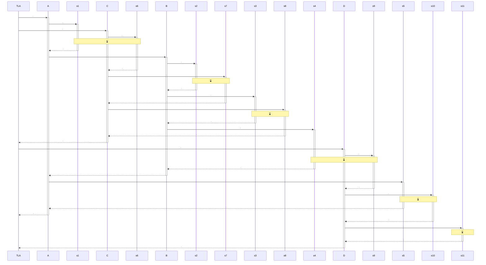
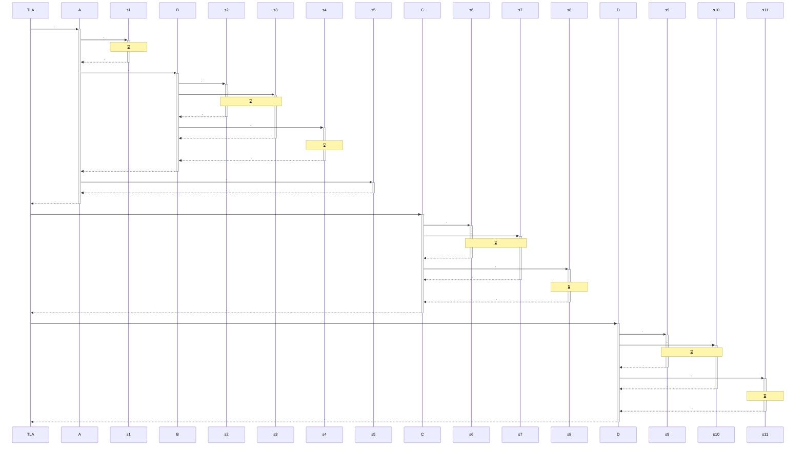

# Parallel execution

## Overview

uss_qualifier has the ability to run elements ("test suite actions") of a test run in parallel.  Test suite actions are test scenarios, test suites, or action generators.  The means to cause this parallel invocation is to add `parallelism_rules` to the [`ExecutionConfiguration`](./configurations/configuration.py) of the test configuration.  By default, every test suite action is invoked with a parallelism of 1 (sequential execution).  However, a parallelism rule can increase this limit by setting `max_parallelism` for all test suite actions that match a particular set of criteria.  Parallelism only makes a difference to test suite actions that spawn multiple test suite actions; specifically, it applies only to test suites and action generators, not to test scenarios.  Moreover, the parallelism limit applies solely to the test suite actions spawned directly by the limited test suite action.

The advantage of parallel execution is speed: test runs can finish much sooner when many of their activities are performed in parallel rather than sequentially.  However, this comes at the cost of both complexity and increased possibility of failure.  A test run with parallelism is more complex than a sequential test run because more things are happening at once, and therefore potentially influencing each other.  The sequence view of a single scenario is almost always sufficient to explain problematic test scenario behavior in a sequential context, but side effects from another simultaneous test scenario may leak into a concurrent test scenario in unexpected ways at unexpected times.  Moreover, isolation of test scenarios is more difficult when they are executed concurrently since shared assets (such as a particular geographic area or a single infrastructure component like USS availability representation in the DSS) are no longer allocated by time alone.

See [recommendations](#recommendations) below for using and designing test configurations with parallelism.

## Shared assets

Two test scenarios cannot be run in parallel if they require access to the same shared asset and access to that shared asset is not synchronized.

One common shared asset is airspace.  If test scenario 1 wants to plan flights in a particular location in city X and test scenario 2 also wants to plan flights in this same particular location, then the particular location in city X is a shared asset.  The most common way to avoid this contention is to deconflict the two scenarios by having them use different locations.  This is generally accomplished by shifting/translating a base location by a certain amount according to the index of each scenario wanting to use that location.  A test suite or action generator invoking multiple test scenarios that would potentially contend on a particular location should generally accept a `ResourceProvidingResource[<LocationResourceType>]` (such as a `ResourceProvidingResource[FlightIntentsResource]`) and then use that provider to generate instances of the `<LocationResourceType>`.  The expectation is that a test configuration using such a scenario will supply a provider resource that produces deconflicted resources, such as a `TriangularCascadeSoutheastResource`.

Some shared assets cannot be easily deconflicted for different test scenario instances like airspace/geospatial assets described in the paragraph above.  For instance, a DSS pool only has one set of USS availability statuses; USS availability status in a DSS pool is therefore a shared asset if multiple test scenarios want to manipulate USS availability status in the DSS pool.  In this case, use of the shared asset must be synchronized between different test scenarios.  This can be accomplished by ensuring each scenario can be provided an optional `SharedAssetCoordinatorResource` and uses that resource to secure exclusive use of the shared asset before using the shard asset.

## Examples

### Figure 1

Consider the following test configuration:

### Figure 2

Without parallelism, everything runs sequentially:

### Figure 3

If Suite B is set to a `max_parallelism` of 2, then its direct test suite actions run in parallel up to a maximum of 2 at a time:

### Figure 4

If Suite A is set to a `max_parallelism` of 2, then its direct test suite actions run in parallel, but Suite B's test suite actions are still run sequentially relative to each other:

### Figure 5

If the top-level test suite action is set to a `max_parallelism` of 2, then its direct test suite actions (A, C, D) run in parallel, but all of the test suite actions within these test suites still run sequentially:

### Figure 6

If all lowest-level test suites are set a `max_parallelism` of 2, then a large speedup is still generally achieved, but with a far less complex sequence of events than if the top-level test suite action is set to that `max_parallelism`:

## Recommendations

When designing test configurations involving parallelism, the following practices are recommended.

1. Ensure any test scenarios parallelized do not rely on unsynchronized shared state or assets.
    * For each resource provided to any test scenario to be run in parallel, check whether that resource uses a shared asset.
    * If the scenario does use a shared asset, verify that the suite or action generator invoking all instances of that scenario deconflicts the resource, or else provides a means of coordinating access to the shared asset.
    * If a scenario has uncoordinated access to a non-deconflicted/shared asset, ensure multiple instances of that scenario do not run in parallel.
2. Parallelize at the lowest level practical.
    * E.g., prefer [Figure 6](#figure-6) over [Figure 5](#figure-5).
3. Avoid multi-level parallelization (parallelization of a test suite/action generator and one or more of its descendant test suites/action generators) unless the behavior and consequences have been very carefully considered.
    * Recommendation motivation: Nested parallel behavior can be very hard to reason about conceptually.  Effective max parallelism can become as high as the product of all nested `max_parallelism` values.
4. Consider excluding `max_parallelism` values from the test baseline initially (via `non_baseline_inputs`).
    * Reasoning: Whether test scenarios are executed in parallel with each other should not affect the substance of the tests performed.  Bugs where test scenarios nonetheless interact with each other are a relatively large risk initially, and this risk can be mitigated by ensuring participants can obtain a passing result for the same test baseline despite these bugs by re-executing the test sequentially.
    * If test run failures are suspected to be caused by issues related to parallelism, reduce `max_parallelism` (all the way to 1 if necessary) until the failures are resolved.
